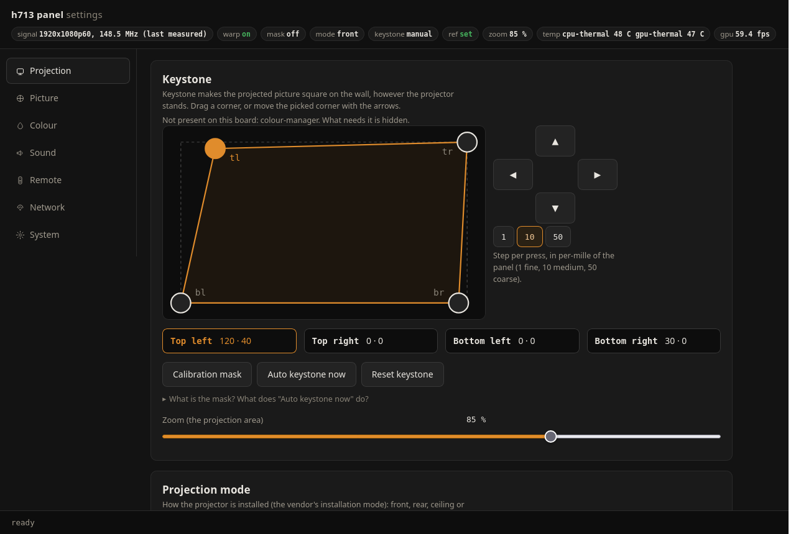

# H713 Linux

> **Read this first.** Everything in this project - the code, the firmware ports, the tools and this documentation -
> was **generated by AI** (Claude, in sessions directed by the maintainer, well0nez), and it is **experimental**.
> It has not yet been reviewed line by line by a human: now that the system has reached a usable state, the plan
> is to go through every subsystem on its own and check and validate it. There is no warranty of any kind. You use
> it at your own risk, on your own device only, and installing it replaces the projector's Android. Take the full
> dump of your device first: a failed install does not brick the projector - the SoC's boot ROM always offers FEL,
> and the board can be reinstalled from there - but without the dump what belongs to this one device (its HDCP
> keys, its MAC addresses, its display firmware and calibration) may be lost for good. The known problems are
> listed openly in [docs/known-issues.md](docs/known-issues.md); read them before you decide.

Mainline Linux **6.18** and an open boot chain (U-Boot SPL, TF-A BL31, U-Boot, Linux) on projectors built around the
Allwinner **H713**: Debian 13, the HDMI input with picture and sound on the wall, Kodi, a small desktop and a browser,
a launcher and a settings page driven by the stock remote, keystone and autofocus. No vendor source code and no vendor
Android: the device's own display firmware, its ARISC firmware, its Wi-Fi firmware and its picture tables are taken
from **your own** device dump at install time and are never part of this repository or of an image.

> **Help wanted - contributors and testers.** This project is looking for people who want to take part:
> owners of an H713 projector who test an image or report their board (open an issue with the model and, if you
> have it, the output of the read-only [probe](docs/tools/h713-probe.md); [boards/README.md](boards/README.md) lists
> what is known), people who review the code one subsystem at a time - all of it was written by AI and needs human
> eyes -, and anyone who fixes or improves something. **Pull requests are very welcome.** What does not work yet:
> [docs/known-issues.md](docs/known-issues.md); how to work in this repository: [AGENTS.md](AGENTS.md).

[](https://ko-fi.com/well0nez)

**Working on this repository, as a person or as an agent?** Start at [AGENTS.md](AGENTS.md).

**See it running** - the HDMI input on the wall, test pattern and audio in sync (2026-09-08):
https://github.com/user-attachments/assets/75bb0b88-038e-4703-a6f9-def8eb071986

## What you get

The current release is **v0.97-beta** (built 22.10.2026, installed and measured on the two boards below). What it does,
each line measured on a device and dated in [STATUS.md](STATUS.md):

| | |
|---|---|
| **Boots on its own** | mains on, power key, the device's own boot logo after 2 s, Linux after 3.5 s; off is U-Boot's power-on gate at 2.9 W, silent, and the power key on the projector **or on either stock remote** starts it again |
| **HDMI input** | 1080p60 and the other modes of the display firmware's own table, hot plug, picture controls, aspect, the firmware's magnifier; HDCP 1.4 and 2.2 with the keys of your own device; sound through the speaker, lip-sync, one volume |
| **The launcher** | the stock remote's Home key opens a menu over the whole picture: HDMI input, Kodi, Browser, Desktop, Settings. It is also what the projector shows when it has started ([guide](docs/guides/launcher.md)) |
| **Kodi, a desktop, a browser** | Debian's Kodi, labwc with a terminal, and Firefox, each as a mode of the box, drawn through the keystone; hardware video decode (H.264, HEVC, VP8, VP9) behind the IOMMU ([h713-desktop](docs/tools/h713-desktop.md)) |
| **Settings on the wall** | a settings page driven by the remote: picture, white balance, keystone, sound, focus, input, power, Wi-Fi ([guide](docs/guides/settings.md)) |
| **Settings in a browser** | the web panel at `http://<the projector>:8080/` for a phone or a PC, in seven sections (Projection, Picture, Colour, Sound, Remote, Network, System) - among them the keystone as a drawing whose corners you drag; password protected, the way without the remote ([guide](docs/guides/settings-page.md), picture below) |
| **The stock remote** | over Bluetooth (hold Left+Right to pair) and over infrared, both stock remotes of these projectors; volume, mute, focus, Home, the launcher and the pages; overlays over the picture ([guide](docs/guides/remote.md)) |
| **Keystone and zoom** | the picture squared up on the Mali GPU, by hand or from the tilt sensor, four projection modes, the vendor's soft edge ([guide](docs/guides/keystone.md)) |
| **Autofocus and focus** | the vendor's search rebuilt with the built-in camera and the focus motor, and the focus by hand ([guide](docs/guides/autofocus.md)) |
| **Wi-Fi, Bluetooth, camera** | AIC8800 as access point or client; the camera as a V4L2 device |
| **Recovery** | FEL from software, the eMMC as a USB drive, stock Android restorable byte for byte from your dump |



*The web panel (`h713-panel`) in a PC browser, rendered from the real page with test values.*

**What it does not do, and what is wrong**, in one place: [docs/known-issues.md](docs/known-issues.md). The three that
matter most:

- **No standby.** The release runs the vendor's ARISC firmware and offers no suspend; off is the power-on gate at 2.9 W.
  Our own ARISC firmware, crust, has a 0.3 W power-off and a standby, but with it the power supply hums or whines, so it
  stays in the image as an **experiment** only (`h713-arisc set crust`). Why: [arisc](docs/subsystems/arisc.md), decided
  22.10.2026.
- **The picture flickers faintly** at every key press and whenever a program starts (HY310). Measured so far: the lamp's
  light follows the current the SoC draws. That the CPU load is the cause of the flicker you see is a **hypothesis, not
  proven**; the owner and a tester still see it.
- **The HY300 (Pro) of a tester** (issue #1, an older model) does not react to its infrared remote yet.

**These projectors have no HDMI output.** The projector itself is the only display; HDMI is an *input*.

## Boards

One directory per board under [`boards/`](boards/README.md). Find your projector in the *Sold as* column: the ids follow
the circuit board, and one board is sold in several projectors.

| Board id | Sold as | DRAM | Panel | State |
|---|---|---|---|---|
| [`hy310`](boards/hy310/) | MagCubic HY310 | DDR3 792 MHz | 1920x1080 dual (0x30) | **verified**, release image |
| [`hy200-qz713df-a1`](boards/hy200-qz713df-a1/) | HY300PRO-G-EU (2025-05 firmware) | DDR3 792 MHz | 1280x720 (0x34) | **verified** for that firmware variant (`projector05061226`), release image; the "HY300 Pro+" variant of 2025-09 is profile only |
| [`hy300-pro`](boards/hy300-pro/) | MagCubic HY300 Pro (2024) | DDR3 636 MHz | 1280x720 (0x34) | in test by its owner ([issue #1](https://github.com/well0nez/allwinner-h713-linux/issues/1)), test images only |
| [`hy200-qz713-v2`](boards/hy200-qz713-v2/) | "HY300 Pro+" (2025, LPDDR3) | LPDDR3 720 MHz | 1280x720 (0x34) | profile only |
| [`hy300-t08`](boards/hy300-t08/) | HY300 T08 (2024) | DDR3 640 MHz | 1280x720 (0x34) | profile only |
| [`hy350`](boards/hy350/) | HY350 (2024) | DDR3 792 MHz | 1920x1080 (0x30) | profile only |
| `l018` | L018 (2025) | unknown | unknown | profile only, no board directory |
| [`losei-x9`](boards/losei-x9/) | LOSEI X9 (2024) | DDR3 744 MHz | 1280x720 (**0x33**) | partial - reported in [issue #3](https://github.com/well0nez/allwinner-h713-linux/issues/3) (25.10.2026), nothing of ours has run on it |

**The rule: no image for a board nobody has tested.** A board becomes *verified* when its owner reports a green run of a
test image built for it; until then it gets the read-only probe, a profile, and a test image for its owner alone.
**Your projector is not in the table?** The installer stops before it writes anything and prints one row about the device
(`installer/h713-install identify`). Please [open an issue](https://github.com/well0nez/allwinner-h713-linux/issues) with
that row.

## Read order

1. [docs/known-issues.md](docs/known-issues.md) - what does not work, before anything else.
2. [FLASHING.md](FLASHING.md) - dump your device, install, first boot.
3. [docs/usage/first-hour.md](docs/usage/first-hour.md) - the first hour: remote, launcher, picture, settings, off and on.
4. The guides: [the remote](docs/guides/remote.md), [the launcher and the modes](docs/guides/launcher.md),
   [the settings page on the wall](docs/guides/settings.md), [switching off and on](docs/guides/power.md),
   [keystone](docs/guides/keystone.md), [autofocus](docs/guides/autofocus.md), [the web page](docs/guides/settings-page.md).
5. [STATUS.md](STATUS.md) - what is measured, with dates; [ROADMAP.md](ROADMAP.md) - what is missing and what it would take.
6. [docs/hardware.md](docs/hardware.md) and [docs/architecture.md](docs/architecture.md) - the board, and the three
   processors in the SoC; read the second before any subsystem page.
7. [BUILDING.md](BUILDING.md) - a clean clone to an image, one command; [RELEASES.md](RELEASES.md) - what a version
   number and a build stamp mean.

Every documentation page is listed in [docs/README.md](docs/README.md). The German working journal under
[`doku/`](doku/README.md) is the evidence behind the documentation, not a manual.

## Getting it running

```bash
release/build-all.sh --version v0.97-beta --board hy310 --profile media,desktop --vendor <your extraction>
installer/h713-install --help          # identify, dump, install, restore
```

The image ships **no proprietary files**: the display firmware, the ARISC firmware, the Wi-Fi firmware, the picture
tables and the boot logo come out of **your own** dump during installation ([h713-extract](docs/tools/h713-extract.md)).
Nothing here needs a licence you do not already have.

## Layout

```
mainline/        the kernel and boot chain: patch series (patches/kernel/series), build scripts, pins, forks as submodules
uboot-h713/      our U-Boot commits as patches, generated from the fork (read-only mirror)
tfa-h713/        our TF-A (BL31) commits the same way
crust-h713/      our port of crust, the open ARISC firmware, the same way
installer/       h713-install, h713-mkimage, h713-extract and helpers
rootfs/          the Debian 13 recipe: package lists, overlays, install script, tests
userspace/       the tools on the device: h713-tv, h713-warp, h713-osd, h713-keys, h713-settings, h713-power and the rest
release/         build-all.sh, the gates (tor.sh, sperr-scan.py), the journal index
boards/          one directory per board
docs/            this documentation (English)
doku/            the German working journal: every measurement, every wrong turn, dated
```

## Licence

Code **GPL-2.0** ([LICENSE](LICENSE)), documentation **CC BY-SA 4.0** ([LICENSE.docs](LICENSE.docs)). Use it, change it,
build on it - keep the notices and credit **well0nez**. What comes from whom, and what is deliberately absent:
[PROVENANCE.md](PROVENANCE.md).

## Credit

The H713 driver series (`0001` - `0022`) is well0nez's work; **cstenger** built the arm64 side around it
([cstenger/allwinner-h713-mainline](https://github.com/cstenger/allwinner-h713-mainline)) and wrote the video decoder
series this release carries. Everything above `0049` - the projector itself - is well0nez's, written with AI as
described at the top of this page.
