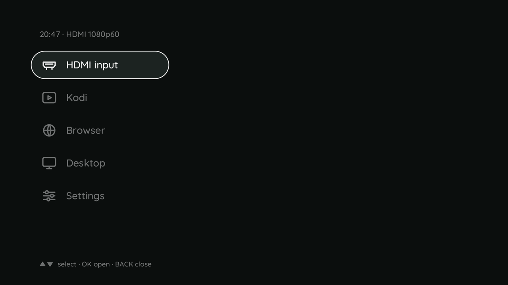
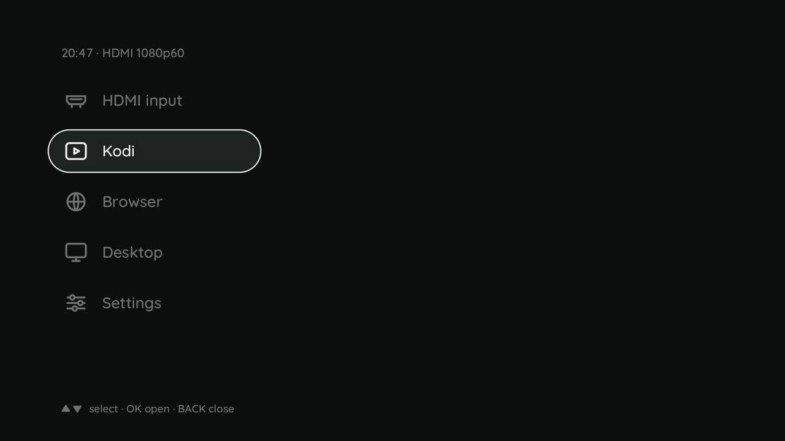
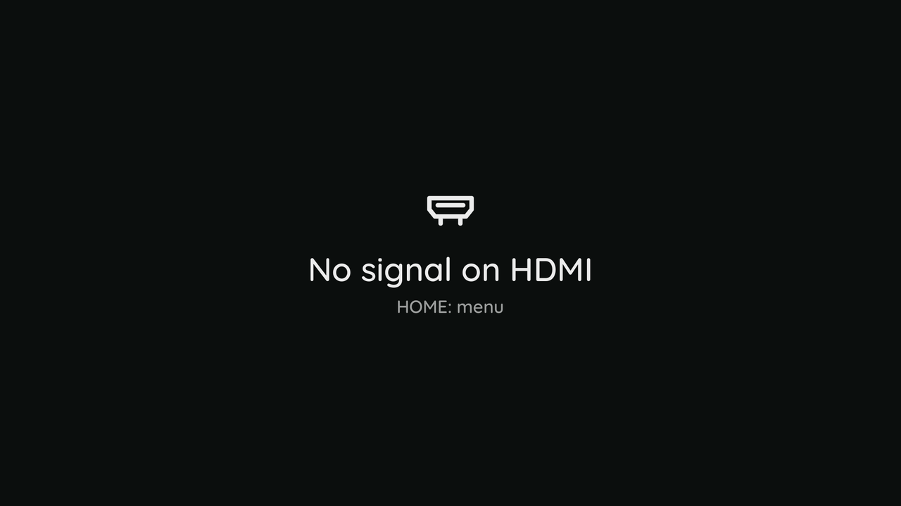

# The launcher

The projector starts into this page, and **Home** opens it over whatever runs. **Up** and **Down**
move, **OK** starts the entry, **Back** closes the page, **Home** goes home.

| Entry | What you get |
|---|---|
| HDMI input | the picture of the source on the HDMI port |
| Kodi | the media player, with hardware decoding up to 4K |
| Browser | Firefox, maximized |
| Desktop | a small desktop with a terminal and a menu |
| Settings | the settings page ([the settings page](settings.md)) |

After OK on Kodi, Browser or Desktop the page says "Starting ..." and stays until the program's first
picture is on the wall, so the wall is never black in between. A program that ends - Kodi's Exit, the
browser closed, a crash - brings the launcher back with HDMI input chosen. Back on the settings page
brings the launcher back too; Home closes everything and shows what runs.

Without an HDMI signal the wall shows this page instead of the Linux console. A **Standby** entry
appears only on an image built with the standby ([switching off and on](power.md)); the release has
none.

What the projector shows after a start is a row of the settings page (Input, On start): the launcher,
the HDMI input, one of the modes, or what ran last. How the entries are defined and how the page is
drawn: [h713-keys](../tools/h713-keys.md), [h713-osd](../tools/h713-osd.md).
