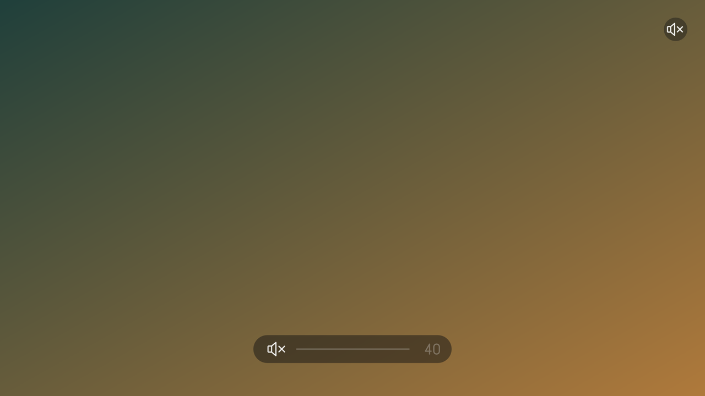
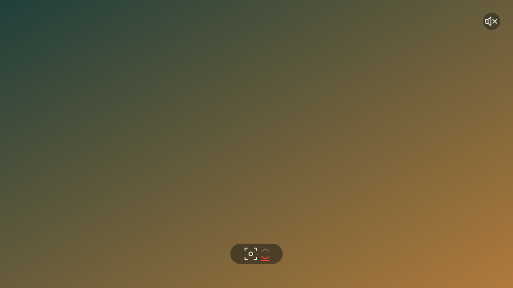

# The remote

Both stock remotes work from the first press, over infrared. The remote that came with the HY310 and
the HY300PRO-G-EU also talks Bluetooth, which adds the air mouse; pair it once.

## Pair the Bluetooth remote

1. Hold **Left + Right** on the remote until its LED blinks.
2. The projector bonds it by itself within a few seconds (`h713-remote-pair status` says so over SSH).
3. From then on it reconnects at the first key press, also after a reboot. Until the link is up the
   keys arrive over infrared, so nothing is lost.

A remote that was paired with another box since no longer matches: hold Left + Right again and the
projector pairs it afresh ([h713-remote-pair](../tools/h713-remote-pair.md)).

## What the keys do

| Key | Does |
|---|---|
| **Power** | a short press shows the 15 s countdown, a long press switches off; in the dark gate it starts the projector ([switching off and on](power.md)) |
| **Home** | opens the launcher; with it open Up, Down, OK and Back belong to the launcher ([the launcher](launcher.md)) |
| **Volume up / down**, **Mute** | the speaker, with an overlay at the foot of the picture; a small badge stays in the corner while muted |
| **The two focus keys** | move the focus by 20 steps per press; the arrow turns red at the end of the travel |
| **Up, Down, Left, Right, OK, Back, Menu** | the launcher, the settings page, Kodi, the desktop and the browser |
| **Mouse key** | over Bluetooth: the air mouse, OK is the left button; over infrared it does nothing |

Over infrared both remotes send the same keys; on the HY300's remote the focus keys are the one with
the double arrow and the one with the screen symbol. The size of a volume or focus step is in
`/etc/h713/keys.conf` ([h713-keys](../tools/h713-keys.md)); how the keys reach Linux is
[the remote subsystem page](../subsystems/remote.md).
