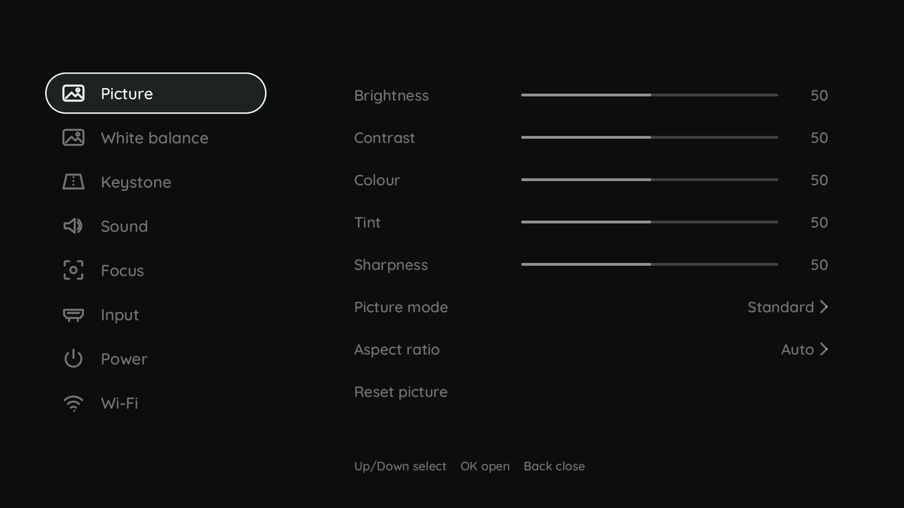
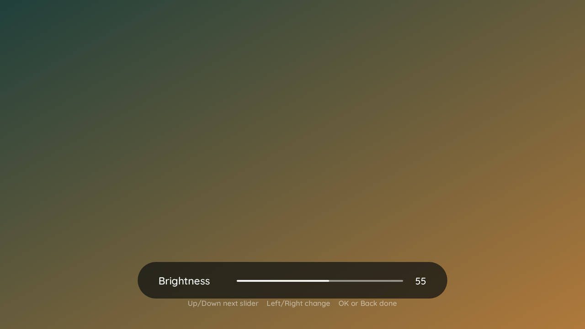
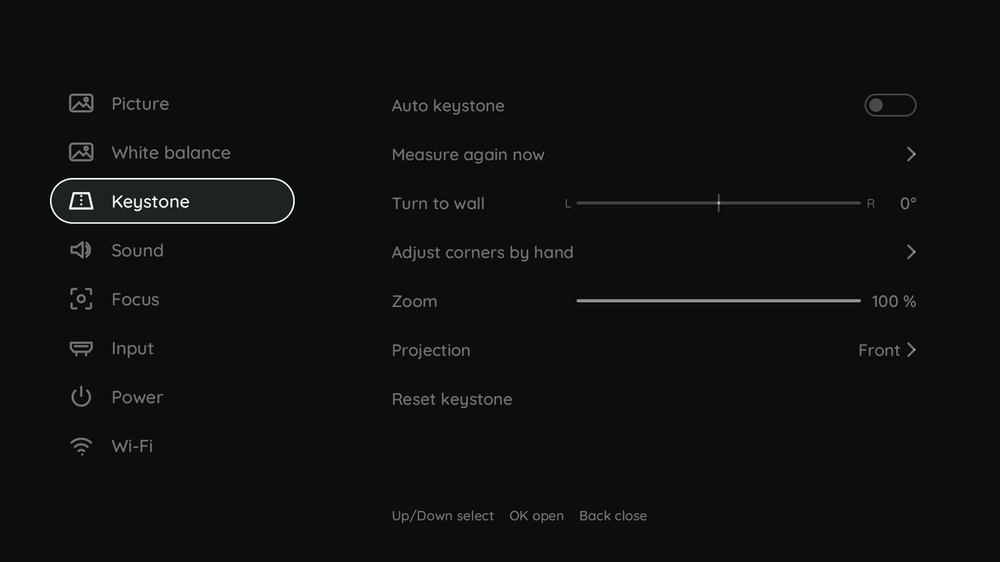
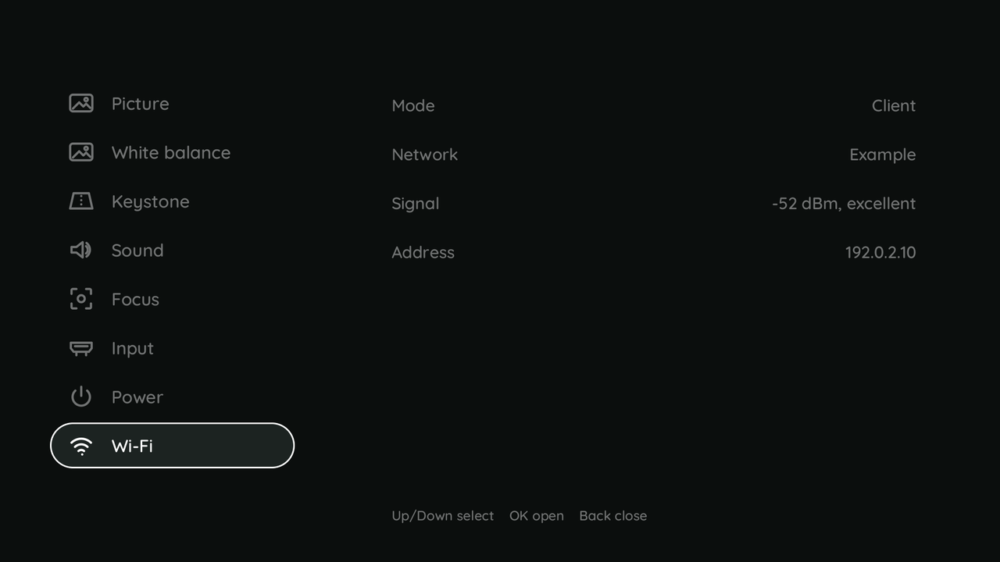

# The settings page

**Settings** in the launcher opens it; the remote drives it. **Up** and **Down** choose an area,
**Right** or **OK** go into its rows, **Left** and **Right** change a value, **OK** opens a choice or
runs an action, **Back** goes one level back - and at the top level closes the page, which brings the
launcher back.

| Area | What is there |
|---|---|
| Picture | brightness, contrast, colour, tint, sharpness, gamma, picture mode, aspect ratio, reset |
| White balance | colour temperature (auto, warm, normal, cool), warm - cool, green - magenta, reset |
| Keystone | the automatic after a move, measure again now, turn to wall, the corners by hand, zoom, projection mode (front, rear, ceiling), reset |
| Sound | volume, mute |
| Focus | autofocus now, autofocus after a move, focus by hand |
| Input | what the projector shows after a start, what is on the wall now |
| Power | what the power key does, the remote's power key |
| Wi-Fi | mode, network, signal and address - shown, not changed: a password needs a keyboard, so edit `/etc/h713/wifi.env` over SSH |

A slider you judge on the picture - brightness, the colour temperature, turn to wall - shrinks the
page to one pill at the foot, over the real picture, at the first press of Left or Right; OK or Back
bring the page back. Every value acts at once and is kept for the next boot by the tool that owns it.

Rows of hardware the board does not have (camera, accelerometer, focus motor) are hidden. The colour
of the single primaries is not offered: the display firmware's colour manager has no visible effect on
the HY310. What every row sends: [h713-settings](../tools/h713-settings.md). The same settings, and
the keystone as a drawing with corners you drag, are on the web page for a phone or a PC browser
([the settings as a web page](settings-page.md)).
