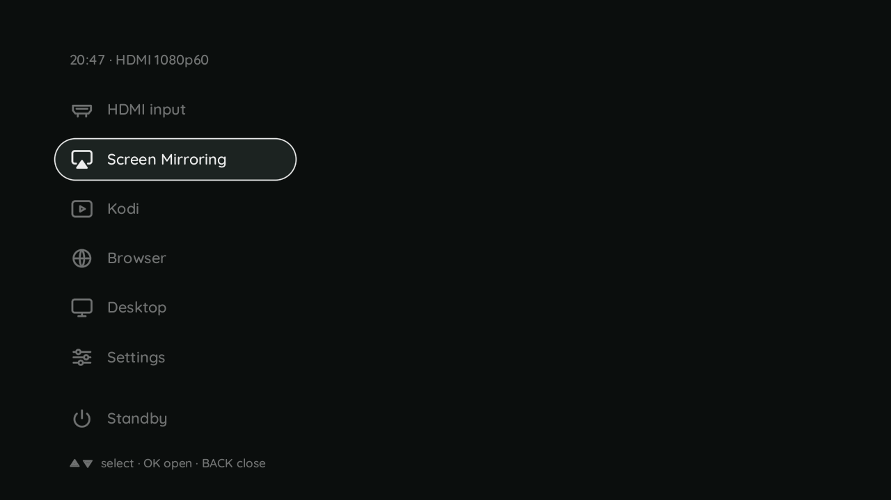

# h713-airplay - AirPlay screen mirroring

An iPhone, iPad or Mac lists the projector in Control Center > **Screen Mirroring** as soon as it is on the same Wi-Fi - the
box's own access point or the network it joined - and mirrors its screen onto the wall, through the keystone, as onto an Apple TV:
no PIN, no app. When the phone stops, the projector is where it was: the launcher. The launcher has a **Screen Mirroring** entry
with a waiting page that says what to do. Two programs in Rust, the receiver (always on) and the presenter (a mode, like Kodi);
source, the contract between them and how they are built: `userspace/h713-airplay/README.md` (GPL-3.0-only: `crates/fairplay`
carries fcast's `apple-fairplay`, a port of playfair).

```
h713-airplay ctl status          # the state, the name, mDNS, the addresses and the Wi-Fi a sender must be on, the sender, the stream
h713-airplay ctl watch           # one line per change of the state, until the client closes
journalctl -u h713-airplay -u h713-airplay-show
```

In development (branch `feat/hy320-airplay`, 05.11.2026), profile `desktop`: host tests only, nothing of it measured on a box yet
([Measured](#measured)).

## The two units

| Unit | Runs | Does |
|---|---|---|
| `h713-airplay.service` | always (`multi-user.target`) | the receiver, `h713-airplay run`: mDNS (`_airplay._tcp`, `_raop._tcp`, a responder of its own: no avahi in the image), RTSP on TCP 7000, the pairing (`fp-setup`), SETUP/RECORD/TEARDOWN, the encrypted mirror stream (TCP 7100) and screen audio (UDP 6000/6001), the clock towards the sender (UDP 7011), the control socket `/run/h713-airplay/ctl`. It decrypts and decodes nothing |
| `h713-airplay-show.socket` | always (`sockets.target`) | listens on `/run/h713-airplay-show.sock` (root and the group `h713-airplay`, 0660) |
| `h713-airplay-show.service` | a **mode unit**, started by systemd when the receiver connects to that socket | the presenter, `h713-airplay-show`: decodes H.264/H.265 on the video engine (FFmpeg 7.1's VA-API -> libva-v4l2-request -> cedrus), puts the pictures through h713-warp's Wayland server (keystone, overlays; h713-tv stays the master), plays AAC-ELD/ALAC on ALSA `default`, the DSP bridge (S16, 48 kHz) |

**Why two:** the receiver must be there all the time and cost nothing: idle, every thread of it blocks in a syscall - no decoder,
no GPU, no Wayland connection, no timer. The presenter is a **mode**, so the launcher, the remote, `h713-mode hdmi`, a standby and
`Conflicts=` treat AirPlay exactly as they treat Kodi, with no case of their own. Both run as the system user `h713-airplay`
(`/usr/lib/sysusers.d/h713-airplay.conf`, home `/var/lib/h713-airplay`, no shell), hardened as `h713-warp.service` is
(`NoNewPrivileges`, `ProtectSystem=strict`, `ProtectHome`, `PrivateTmp`, `RestrictSUIDSGID`, `MemoryDenyWriteExecute`); the
presenter has the groups its devices ask for, `video render audio`. Every port is above 1024, so neither needs a capability.
The receiver's key pair and device id are kept in its `StateDirectory`, `/var/lib/h713-airplay`: a sender sees the same receiver
after a reboot.

The presenter's unit, as Kodi's: `Conflicts=` with Kodi, the browser and the desktop (one client of h713-warp at a time; a phone
that starts to mirror stops them, and a start of one of them stops the stream), `After=` them so that the stop comes first,
`BindsTo=h713-warp.service`, `ExecStartPre=+h713-kodi-switch source` (a program is the mode: no HDMI ring while it starts), no
`[Install]`, `TimeoutStopSec=5s`. The VA-API driver's environment is `/etc/environment.d/h713-media.conf`, read by the unit itself.

## The session, start to end

1. `idle`: advertised, nothing else runs.
2. A sender connects: `GET /info`, `POST /fp-setup` (twice), perhaps pairing - `connected`.
3. It sets up the mirror stream (type 110): the receiver connects to `/run/h713-airplay-show.sock`, systemd starts the presenter
   (its `Conflicts=` stop Kodi, the browser or the desktop first) - `starting`. What the sender sends before the presenter reads is
   kept from the last key frame on (at most 8 s), so the presenter decodes it all and shows the newest: no corruption, no backlog.
4. The presenter answers `Ready` - `streaming`. [h713-keys](h713-keys.md) sees a mode unit come up that it did not start and makes
   way: an open launcher closes, and a page that would come back to the launcher (the waiting page, Settings) is stopped, so the
   picture is on the wall at once.
5. The end, one of:
   - the sender stops (TEARDOWN, with or without a stream type - iOS 27 sends none - or its connection drops): the receiver sends
     `End`, the presenter exits 0, the unit ends by itself, and h713-keys opens the launcher with HDMI input chosen; h713-warp gives
     the panel back to the HDMI ring two seconds after its last client is gone;
   - the remote: HDMI input in the launcher (`h713-mode hdmi`: the end is the user's, no launcher), another mode (Kodi:
     `Conflicts=`); Home opens the launcher over the stream as over Kodi, and Screen Mirroring in it only closes it again;
   - a standby: `h713-mode sleep-pre` stops the unit; after the wake it is started again, finds no session and ends.
   The presenter's connection closing is the receiver's sign to end the session: the sender is told (its connections closed), and
   the state is `idle` again.
6. A second sender while one streams takes over (`takeover = on`, Apple TV's way); with `off` it is answered 409.

No jitter buffer: a frame is decrypted and decoded when it arrives, the display queue holds one picture (the newest wins, older
decoded ones count as dropped), the decoder sees every frame. Audio: a bounded queue (the oldest goes past 120 ms) and about 60 ms
in ALSA's buffer; video and audio play when they arrive.

## The launcher entry

`/etc/h713/launcher.d/15-airplay.conf` (profile `desktop`):

```
label  = Screen Mirroring
icon   = airplay
unit   = h713-airplay-show.service
exec   = /usr/bin/systemd-run --quiet --collect --wait --unit=h713-airplay-page /usr/local/bin/h713-airplay page
return = launcher
active = /usr/bin/systemctl is-active --quiet h713-airplay-show.service
now    = AirPlay
```

An entry with both `unit` and `exec` (h713-keys, 05.11.2026): the unit is its mode - `h713-mode` ends it before a sleep and for the
HDMI input, h713-keys watches it and keeps it in `last-mode`, the header says "AirPlay" while it runs - but the launcher never starts
it. **OK runs `exec`, the waiting page, while the unit is down, and only closes the launcher while it is up** (the stream is the mode on
the wall). `on_start` does not take the entry, and `on_start = last` after a stream opens the launcher: a stream does not come back by
itself. The symbol is libh713osd's `airplay`, Apple's screen mirroring glyph; with it the image has seven entries with Standby, which
the launcher draws a little smaller than six ([h713-osd](h713-osd.md)).



## The waiting page

`h713-airplay page` (`crates/page`): an opaque page through h713-osd's page channel, in the launcher's ground and face (Quicksand,
`0xff0b0e0d`, the pill `0x1c2321`, the 5 % safe margin), English like the launcher:

```
Screen Mirroring
HY320                                                      the AirPlay name, large
On your iPhone, iPad or Mac: open Control Center, tap Screen Mirroring, choose HY320.
Wi-Fi  h713          IP  192.168.4.1                       from `ctl status` (wifi, addrs), every interface the receiver answers on
Ready                                                      or "Connecting to Peter's iPhone..." / "AirPlay is not running"
BACK close
```

It follows the receiver with `watch` (no polling) and holds the remote while it is open, as h713-settings does (`EVIOCGRAB`). Its exit
status is h713-settings' convention, which the entry's `return = launcher` reads through `systemd-run --wait`:

| Status | When | Then |
|---|---|---|
| 0 | Back | the launcher opens again, Screen Mirroring chosen |
| 10 | Home | everything closes, the mode below is on the wall |
| 11 | Power | handed to h713-power, as h713-settings does |
| 14 | h713-osd gone | nothing opens |
| 15 | a signal (h713-keys stops the page's unit when a stream comes up) | nothing opens |
| 16 | a stream took the wall | the page goes and the stream is on the wall |

A page that h713-keys stopped for a stream opens nothing whatever its status.

## Configuration

`/etc/h713/airplay.conf` (`crates/proto/src/config.rs`; every key is in the image's file with its default, commented out), `key = value`,
`#` a comment. The receiver reads it at its start - `systemctl restart h713-airplay` after a change -, the presenter at every stream. A
line it does not understand is a warning in the journal; the other lines still count.

| Key | Default | Range |
|---|---|---|
| `name` | the host name in capitals (`HY320`), else `H713` | 1 to 63 characters: what a sender lists |
| `port` | 7000 | 1024..65000, TCP (RTSP); the mirror stream is `port + 100`, the clock `port + 11` (UDP); screen audio always UDP 6000/6001 |
| `width`, `height`, `fps` | 1920, 1080, 60 | 640..3840, 480..2160, 24..60: the display the receiver offers; a sender scales its screen into it |
| `hevc` | `on` | `on`/`off`: H.265 besides H.264 (iOS 27 sends nothing usable without it) |
| `audio` | `on` | `on`/`off`: screen audio |
| `audio_device` | `default` | an ALSA device for the presenter; `default` is the DSP bridge |
| `takeover` | `on` | `on`/`off`: a second sender replaces the one that streams, or is answered 409 |
| `interfaces` | (empty) | interface names separated by spaces; empty: every interface that is up and has an address |

## ctl

`h713-airplay ctl COMMAND` - one command per connection on `/run/h713-airplay/ctl` (`crates/proto/src/ctl.rs`); the answer's first word
is `ok` or `error`, as with `h713-warp ctl` and `h713-osd ctl`. Exit 0 on `ok`, 1 on `error`, 3 when the receiver is not there.

| Command | Answer |
|---|---|
| `status` | `ok status`, then one line each: `state`, `name`, `mdns`, `addrs` (`192.168.4.1@wlan0`), `wifi` (`h713@wlan0`), `client`, `video`, `audio`, `presenter`, `sessions` |
| `wait STATE [MS]` | `ok STATE` as soon as the receiver is in STATE (at once if it is), `error timeout NOW` after MS (default 10000) |
| `watch` | `ok watch`, then `state STATE` at every change, the first line the state now, until the client closes |
| `disconnect` | `ok` once the session is ended (`ok idle` when there was none) |

The states are `idle`, `connected`, `starting`, `streaming`. `wait` and `watch` are how tests and the waiting page follow the receiver
without polling.

## In the image

The desktop profile's overlay carries the units, the launcher entry, the user and `/etc/h713/airplay.conf`; `rootfs/install-projekt.sh`
(5l) installs `h713-airplay` and `h713-airplay-show` to `/usr/local/bin` and their README to `/usr/local/share/doc/h713-airplay/`,
enables `h713-airplay.service` and `h713-airplay-show.socket`, and does all that only for a tree that carries those units: a base or a
`media` image has no AirPlay. No Debian package of its own: mDNS is the receiver's, and the presenter's libraries - FFmpeg's libavcodec,
libva, ALSA, EGL and Wayland - come with the profiles: **AirPlay is an image with `desktop` and `media`** (`--profile media,desktop`).
`build-rootfs.sh` checks the files, the entry's unit, exec and way back, the socket's path and group, the users and that both units are
enabled.

## Limits

- Screen mirroring only: the stream a sender's Screen Mirroring sends, one sender at a time.
- No password and no PIN: everyone on the box's network can mirror (`takeover = on`: and take the wall from another phone).
- The page's Wi-Fi line comes from `/etc/h713/wifi.env` (`crates/receiver/src/net.rs`), which is root's and 0600 (it carries the
  password): the receiver, running as `h713-airplay`, cannot read it, and the line stays empty until the receiver finds the network
  another way (found 05.11.2026 while writing the units; not measured on a box).
- The launcher draws seven entries at most; an eighth (a package that adds one) is refused by h713-osd, and Home then opens nothing.

## Measured

Nothing on a box yet. To be filled after the device's acceptance:

- From Screen Mirroring on the phone to its picture on the wall: not measured yet.
- Glass to wall (the phone's screen to the projected picture): not measured yet.
- The receiver idle (CPU, wakeups, memory): not measured yet.
- The presenter: hardware decode, frames per second, dropped frames over ten minutes, H.264 and H.265: not measured yet.
- Sound against the picture, and its delay: not measured yet.
- The ways in and out - the launcher closing when a stream comes, the waiting page ending with 16, the launcher after the phone
  stops, HDMI input, Kodi over a stream, Home and Screen Mirroring over it, a second phone taking over, a standby during a stream: not
  measured yet (h713-keys' side: host tests, `tests/test_keys.py`).
- The senders and their versions (iPhone, iPad, Mac; iOS 27): not measured yet.
