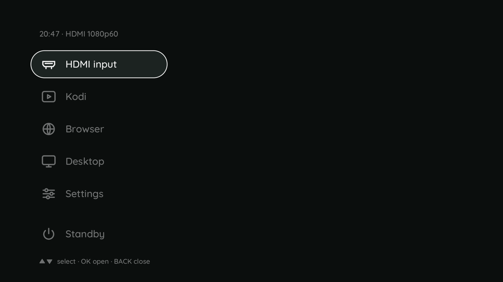

# h713-keys - the stock remote's keys

`h713-keys` gives the stock remote's keys their meaning on our image: volume and mute through `h713-tv`, the
focus through [h713-focus](h713-focus.md), Home for the launcher (below), and - once a key is chosen for it - one key
that switches between the HDMI picture and the console. It reads the Bluetooth LE remote and the IR receiver alike; a dependency-free
Python 3 daemon, run by `h713-keys.service`. Source and the key table: `userspace/h713-keys/README.md`.

```
h713-keys status         # configuration, the remote's input devices, whether h713-tv and h713-osd answer
h713-keys run            # what the unit runs
```

## Which key does what

| Key (kernel name) | Action |
|---|---|
| `KEY_VOLUMEUP` / `KEY_VOLUMEDOWN` | `h713-tv ctl volume N` in steps of `volume_step`; both lift a mute first (the owner's choice of 11.10.2026) |
| `KEY_MUTE` | toggles `h713-tv ctl mute`; held down it does not repeat |
| `KEY_F4` / `KEY_F5` (the BLE remote's focus keys, kernel 0169; IR 0x0251/0x0250, on the HY300's IR remote 0x0098/0x0093) | `h713-focus up/down` with `focus_steps`; one run at a time, presses during a run wait for the next (at most two presses' worth, so a held key keeps the motor going and it stops one run after the release), a press the other way replaces what was waiting. At the end of the travel (`h713-focus` exit 3) the overlay shows the end stop and nothing more is queued that way. The end stop picture is the other direction's: a run up ends with `focus down edge`, a run down with `focus up edge` (the owner's eye at the wall, 16.10.2026: the run he drove down to its stop showed the top edge picture; `doku/213` §6 - his instruction, not a root cause: why the direction is reported the wrong way round is open) |
| `input_keys` (none by default) | `h713-tv ctl off` (console) when the picture is on automatic, `h713-tv ctl auto` otherwise. The remote has no record key; which key gets this is open |
| `KEY_POWER` | left alone: [h713-power](h713-power.md) reads it from the same nodes - a short press shows the countdown, the release powers off into U-Boot's gate |
| `KEY_HOMEPAGE` | opens the launcher (below); with it open Up, Down, OK, Back, Home and Power are the launcher's |
| Menu, Back, arrows, OK | with the launcher closed: logged once as "recognised, no action yet" (they are Kodi's); OK arrives as `KEY_ENTER` and Menu as `KEY_COMPOSE` (the udev rule below) and is read as `KEY_OK` |
| `BTN_LEFT` (OK in the remote's mouse mode, where `REL_X`/`REL_Y` move a pointer) | with the launcher open it is read as OK, and the settings page does the same (it reads the remote itself); with both closed it stays a click for Kodi, the desktop and the browser. Host tests only, not yet tried on a box |
| `KEY_F6` (IR `0x0266`: the mouse **and** the microphone key; the HY300's IR remote: its mouse key `0x0082`) | logged once. Over IR both keys send this one code, the vendor's `PRJ_BRC_PAIR`; their own functions run over Bluetooth only. *Superseded 17.10.2026:* "they ask for the Bluetooth pairing, and a second later the remote offers itself (measured 11.10.2026)" - the owner: pairing begins with Left+Right, and these two keys are no way to pair; the fix built on it was dropped (`doku/214` §1). Nothing acts on it: `h713-remote-pair` pairs only while no remote is bonded - a remote paired with another box since needs `h713-remote-pair forget`, then Left+Right (TODO 2.54) |

Volume and mute work without an HDMI signal: `h713-tv` keeps them as long as its two sound cards are there.

## The launcher (Home)

Measured on the HY310 on 15.10.2026 (`doku/212` §1): ten switches HDMI -> Kodi -> HDMI, Kodi taking no key while the page is open, the selection
answered in 52.7 ms over HDMI and 81.8 ms over Kodi, 35 of 35 standbys from every way in. `KEY_HOMEPAGE` opens an **opaque page** over the whole panel (Marco, 15.10.2026: it must have a ground, it is not an overlay over the picture; the picture goes on behind it) with the list on the left - the mock-up's "Launcher C":
a header line with the time and what runs (`20:47 - HDMI 1080p60`, `Kodi`), the entries, set apart at the foot Standby, and
`select / OK open / BACK close`. h713-osd draws it (`launcher ...` on its socket, [h713-osd](h713-osd.md)); h713-keys is the
controller. **Up/Down** move (no wrapping), **OK** does what the entry says and closes, **Back** and **Home** close, a
**Power** press closes it and hands the press to [h713-power](h713-power.md) (a datagram `down`, `H713_KEYS_POWER`: h713-power starts the press, so a 3 s hold still powers off), volume,
mute and focus work as always. It closes by itself after 90 s without a key, and at once when h713-osd no longer shows it (a restart
under an open launcher): a move, and OK before it starts a row, must be answered `ok` by h713-osd, else the launcher is closed and the
grab let go, and nothing is started blind.



**Nothing happens twice.** While the launcher is open h713-keys holds the remote's two devices with `EVIOCGRAB`, so Kodi (which
reads them through cage and libinput) gets no key at all; closed, it lets go and everything is as it was. The press of Home
that opens it still reaches Kodi first, so the Kodi keymap maps `homepage` and `browser_home` to nothing
(`rootfs/overlay-desktop/.../keymaps/h713-power.xml`; Kodi names the key `browser_home`). **The grab waits for the release of
Home** (measured at the HY310, 15.10.2026, gate H2): grabbed with Home still down, the release never reached cage, cage held Home
down, and Kodi - which repeats a key it never saw released - got a `browser_home` 30 times a second for as long as the launcher was
open (harmless, mapped to noop, but not "no key"). The page is on the wall at the press; the keys are the launcher's from the release
on (a Down pressed within the ~100 ms in between would reach both). It opens only where h713-osd can show it: without a signal (the console)
or without h713-osd it answers `ok unseen`/nothing and h713-keys does not take the keys from anybody. A remote that connects
while it is open is held at once.

**The launcher at the start of the box** (Marco, 16.10.2026: the start is where the launcher belongs, not the HDMI picture): with `on_start = launcher` in `keys.conf`
(the default; `hdmi` keeps the HDMI picture; `kodi`, `last` and the other values are below) h713-keys opens the launcher by itself once per boot, with the row of the running mode chosen (HDMI input at a start), as soon as h713-osd can show it. It does not wait for a Home: no release to wait for, so the
devices are held at once. It tries every 0.5 s for 180 s after h713-keys has started, and only once h713-tv's socket is there (before that h713-osd answers `ok unseen`), so the launcher stands before the HDMI picture: 8.2 s against the picture at 9.1 s on the HY310 (17.10.2026, `doku/214` §2; until then every 5 s, and the wall showed 1.3 s of HDMI first). Then it gives up with one warning.
"Once per boot" is `/run/h713-keys.booted`: /run is empty after every boot and stays through a standby and a restart of the service, so a **standby brings back the mode from before** (a standby between the start and the first open ends the attempt: it
sees that the machine slept, `CLOCK_BOOTTIME` ahead of `CLOCK_MONOTONIC`) and a deploy of h713-keys does not pop the launcher up. The launcher opened this way **waits for the first key** (the 90 s idle limit counts only from then on): a start page that vanished while
nobody was at the remote would be the HDMI picture again. The settings page writes the line (Input > On start, [h713-settings](h713-settings.md)); a change counts at the next start of the box. Measured on the HY310, 16.10.2026: four warm starts, the launcher open 10.6 to 10.9 s after the boot, seen by the camera (`doku/213` §4).

**Other starts** (the owner, 17.10.2026): `on_start = kodi` (or the id of any entry with a `unit`) opens the launcher with that entry chosen and takes its OK by itself, so the page says "Starting Kodi..." until the first picture
and then goes; `on_start = last` is what ran when the box went off - `hdmi` (nothing is done), the unit in `last-mode` (as the entry's id), or the launcher if nothing is kept or the entry is gone. Measured on the HY310 (rend5 with this change), one warm start each,
the camera and `h713-osd ctl status` 40 to 47 s after the boot: `launcher` - the page open from 8.7 s, Y 3.0 on all 128 camera frames; `hdmi` - no launcher, Y 58.7; `kodi` - the page "Starting Kodi..." from 8.6 s, Kodi's first picture at 15.0 s, Kodi running, no launcher;
`last` with Kodi running at the restart - Kodi again (page from 8.5 s, picture at 15.6 s; the shutdown did not overwrite `last-mode`); `last` after HDMI - the HDMI picture, no launcher.

**The entries are files**, `/etc/h713/launcher.d/NN-name.conf`, sorted by name (a package adds its own and touches no code):

```
label    = Kodi                  # English, what is written on the wall
icon     = film                  # hdmi film globe desk sliders power (libh713osd)
unit     = h713-kodi.service     # OK: systemctl start --no-block (a "mode"; h713-mode ends it before a sleep and starts it after)
exec     = /usr/local/sbin/h713-mode hdmi    # or: a command, run detached (no shell)
show     = /usr/local/sbin/h713-power can-standby    # optional: the entry exists only if this exits 0
active   = /usr/bin/systemctl is-active --quiet h713-kodi.service    # optional: exits 0 while this entry is what runs
now      = Kodi                  # the header while it is active (default: the label); {signal} = 1080p60 from h713-tv
group    = end                   # the foot: Standby is set apart, bottom-anchored, and comes last
fallback = yes                   # the current entry when no other `active` check succeeds (the HDMI input)
wait     = /usr/local/sbin/h713-kodi-switch ready    # optional, with `unit`: see below
return   = launcher              # optional, with `exec`: the program's end with 0 opens the launcher again, see "The ways back"
```

An entry's **id** is its file name without the number and the suffix (`20-kodi.conf` is `kodi`); `on_start` names it.

**`wait`: the page stays while a client starts** (acceptance of 16.10.2026, `doku/213` §1 and §4: Kodi needs 4 s, Firefox 9 to 13 s to a first picture, and the wall was black or the
old client until then; with the page: Kodi 4.7 to 4.9 s, desktop 1.2 s, browser 6.3 s from HDMI, the wall never black). An entry with `unit` and `wait` does not close the launcher at the OK: it starts the unit, redefines the page with the header
"Starting Browser..." (`launcher SEL;NOW;rows` again, the same command that opened it), and asks every 0.5 s whether the unit is up (`active`) and the `wait` command exits 0;
then the page goes and the client is on the wall. At most 30 s (`START_WAIT_S`), then it goes anyway with a journal line. While it waits, Up, Down and OK are swallowed (a second OK would
start the unit again); Back and Home close the page (the unit goes on starting), Power does what it always does, volume and mute work. The commands in the
image: Kodi `h713-kodi-switch ready` (its JSON-RPC answers once the home screen is up), Browser and Desktop `test -e /run/h713-browser/mapped` and `/run/h713-desktop/mapped`, files that the unit's
labwc touches when a window is first mapped (a `windowRule` with an `Execute` action in `labwc-browser/rc.xml` and `labwc/rc.xml`; the unit's runtime directory goes with the unit, so a
stale file cannot say "ready"). An entry without `wait` closes the page at the OK, as before.

Up to six entries fit the picture (the mock-up's: HDMI input, Kodi, Browser, Desktop, Settings, Standby); the selection starts
on the entry that is active. A file without label, icon and unit or exec is left out with a journal warning. `H713_KEYS_TRACE=1` adds a journal line per key with the kernel's stamp and the read time (gate HL).

## The ways back (Marco, 17.10.2026)

Back goes one level back and Home goes home; whoever ends a program has the remote in hand and chooses.

| From | Back | Home | the program ends |
|---|---|---|---|
| Settings (a page over the mode) | the launcher opens again, Settings chosen | everything closes, the mode is on the wall | |
| the launcher | closes: the mode below | closes | |
| a mode (HDMI, Kodi, Browser, Desktop) | Kodi's, the browser's | opens the launcher | **the launcher opens, HDMI input chosen** (Kodi's Exit, the browser or the terminal closed, a crash) |

**`return = launcher`** (an `exec` entry; the Settings entry): h713-keys keeps the program it started and waits for its end. With exit status 0 it opens the launcher again with that entry
chosen; the header still says what runs. Any other status leaves the wall to the mode below. h713-settings ends with 0 on Back at its top level, 10 on Home, 11 on Power, 12 after 120 s without a key,
13 when the picture did not come back, 14 when h713-osd is gone and 15 on a signal; the entry runs `systemd-run --wait`, whose status is the program's. h713-osd shows one page at a time and answers "the page is open" until it has
seen the page's connection end, so the launcher is asked for again every 0.1 s for up to 5 s. The wall shows the HDMI picture from the moment the page is gone to the moment the launcher is drawn; to keep that short the way back takes
the entries, the row that runs and the signal from the last full open instead of asking `systemctl` and h713-tv again (a full open took 350 ms of the 0.55 s on the HY310, measured 17.10.2026; the rest is h713-osd drawing the page through the keystone, 110 to 150 ms), and the loop wakes on a pidfd of the program, not on a poll.

**A mode that ends by itself.** The mode units are the `unit` lines of the entries. h713-keys looks every 0.25 s whether one has a cgroup under `/sys/fs/cgroup/system.slice` (a `stat`, no process: the cgroup is there while a unit comes up, runs and goes
down). When none has been there for 0.5 s, the mode has ended and the launcher opens with HDMI input chosen - **unless the end was not the program's**:

- `h713-mode hdmi` (the launcher's HDMI input, or a shell) touches `/run/h713-mode.ended` first: the end is the user's, and the launcher does not come back;
- a sleep: `/run/h713-mode.resume` exists from `h713-mode sleep-pre` to `sleep-post`;
- the shutdown: `systemctl is-system-running` says `stopping`;
- the six seconds after the launcher itself started a mode (a switch from one mode to the next has no gap that long);
- the launcher is open already (Kodi crashed behind it): nothing opens a second one; an entry that was starting ("Starting Browser...") and ended before its first picture puts the list back at once, HDMI input chosen, instead of keeping the page for 30 s.

**The mode is remembered** in `/var/lib/h713-keys/last-mode` (`StateDirectory=h713-keys`): `hdmi`, or the unit that ran last. It follows the box through every start and end of a mode, except the end for a sleep (the mode comes back after it) and the end for the
shutdown: what ran when the box went off is what `on_start = last` brings back. The first look after h713-keys has started writes `hdmi` when nothing runs; it waits for the start under `on_start` to be settled, so that the start still finds what was kept.

Measured on the HY310 (17.10.2026, uhid remote, the colour camera, `h713-osd ctl status` and the journal; HDMI and over Kodi): Settings, Back: the launcher is open with Settings chosen, Back again: closed, the mode unchanged (Kodi's JSON-RPC answers);
Home in Settings: everything closed, Home in the mode: the launcher; Back in the launcher: closed, Kodi keeps running. Kodi's Quit, a SIGKILL of its unit, Firefox killed and the desktop's terminal killed each opened the launcher with HDMI input chosen
(`h713-osd ctl status`: launcher open, `h713-mode status`: hdmi). HDMI input from Kodi: no launcher, `source` still `auto`. A standby with Kodi running (RTC alarm): the journal says "ended (a sleep)", Kodi is back, no launcher, `last-mode` still Kodi.
Not measured: the same on the HY300PRO-G-EU (a 720p LCD with the warp in bypass: the paths are the same Python and C, the gap between the pages is h713-osd's), and a power-off with `last` (the restart was measured, a cold start was not).

## OK and Menu below code 248 (`70-h713-remote.rules`)

The remote's OK is `KEY_OK` (352) over IR and `KEY_SELECT` (353, HID "Menu Pick" `0x0c0041`) over Bluetooth; its Menu is `KEY_MENU` (139, `0x0c0040`).
xkb names evdev codes only up to 247, so cage's libinput hands a Wayland client no key above that, and `KEY_MENU`'s keysym (`XF86MenuKB`) is one Kodi does not know:
with the stock codes OK and Menu never reached Kodi (gate H2, 15.10.2026), and would not reach labwc or Firefox either. The rule
`/etc/udev/rules.d/70-h713-remote.rules` (installed with h713-keys) lets udev's `keyboard` builtin change the codes in the kernel, as hwdb's `KEYBOARD_KEY_` does:
OK becomes `KEY_ENTER` (28, Return to every client) and Menu `KEY_COMPOSE` (127, keysym Menu, the context-menu key). IR matches by the device name `sunxi-ir`
(scancodes `0x20b`, `0x21e` of the keymap `rc-h713-fd02`, and `0x7`, `0x13` of the HY300's remote in the same keymap), Bluetooth by the ids 1d5a:c081. h713-keys reads `KEY_ENTER` as OK (and still `KEY_SELECT`/`KEY_OK`, should the
rule not have run); h713-power took `KEY_ENTER` for OK already. `udevadm trigger --subsystem-match=input --action=change` applies the rule to a running box.

## Why it reads only the remote

A keyboard on the USB port has F4, F5 and volume keys too, and someone typing in the console should not
move the focus motor. The daemon opens only the BLE remote (ids `1d5a:c081`) and the IR receiver (input
name `sunxi-ir`), and finds a remote that connects later at its next look, every 5 s. It does not grab the
devices except while the launcher is open: the power key on the same nodes stays with logind or `h713-power`.

A held key repeats the same way over both: the IR receiver repeats after 500 ms every 125 ms (rc-core), and the
daemon gives the Bluetooth remote those values when it opens it (`EVIOCSREP`; the journal line "listening on ...,
repeat 500/125 ms as over IR"). Left at the input core's 250/33 ms, a held volume key ran from 100 to 15 in 1.6 s
(measured on the HY300PRO-G-EU, `doku/195`).

## The overlay

After each action one line goes to `/run/h713-osd/ctl`, the control socket of the overlay daemon
[h713-osd](h713-osd.md): `volume N`, `mute on N` / `mute off N`, `focus up|down [edge]`,
`input console|hdmi`. When the socket is not there, nothing is sent and nothing is logged; the action never
waits for the overlay.

## IR

The IR receiver (`sunxi-cir`, `r_ir`) decodes with kernel 0252-0254. Before 0252 the device tree gave it
24 MHz, and the driver's integer arithmetic turned the 2.667 us sample into 2 us: every pulse reached rc-core
at 0.75 of its length, and NEC never decoded (measured 02.10.2026, leader 6752/3348 us instead of
9000/4500). Without the property the driver runs at 8 MHz, an exact 8 us. 0253 removes the vendor register
values of 0021, which belonged to the vendor's own sample model. 0254 adds the keymap `rc-h713-fd02`
(NEC customer code 0xfd02, scancode = address << 8 | command), built into the kernel. The table comes from the
stock firmware; seven navigation keys were tested on the HY300PRO-G-EU on 03.10.2026 (`doku/138`).

**Two remotes, one keymap (kernel 0329, 22.10.2026).** The H713 projectors ship with one of two IR remotes:
the HY310's (and the HY300PRO-G-EU's) sends NEC address 0x02, the HY300's address 0x00 (customer code 0xff00).
`rc-h713-fd02` holds both - the name stayed for the tools and trees that load it - and the device tree names it
for every board (`sun50i-h713.dtsi`; before 0329 only the HY310's tree did, which two other boards include).
Each key of the 0x00 remote gives the code of the same key on the 0x02 remote:

| Key on the HY300's remote | Scancode | Code |
|---|---|---|
| Power, Mute, Volume up, Volume down | `0x14`, `0x01`, `0x0b`, `0x58` | `KEY_POWER`, `KEY_MUTE`, `KEY_VOLUMEUP`, `KEY_VOLUMEDOWN` |
| Up, Down, Left, Right, OK | `0x03`, `0x02`, `0x0e`, `0x1a`, `0x07` | `KEY_UP`, `KEY_DOWN`, `KEY_LEFT`, `KEY_RIGHT`, `KEY_OK` (udev: `KEY_ENTER`) |
| Home, Back, Menu | `0x48`, `0x5c`, `0x13` | `KEY_HOMEPAGE`, `KEY_BACK`, `KEY_MENU` (udev: `KEY_COMPOSE`) |
| Mouse | `0x82` | `KEY_F6`, like the other remote's `0x66` (the vendor names it MOUSE; there is no IR mouse here) |
| the key with a double arrow | `0x98` | `KEY_F4` - the vendor's PRJ_FOCUS_UP |
| the key with a screen symbol | `0x93` | `KEY_F5` - the vendor's PRJ_FOCUS_DN |

The 15 scancodes were read on the HY300PRO-G-EU on 22.10.2026 with the HY300's stock remote; they are the 15 of
the vendor's table `customer_ir_ff00.kl`, which is also the first entry of the stock wake list. Which way the
focus runs from the two focus keys is not measured yet. Address 0x00 is the one many cheap remotes use
([known issues](../known-issues.md)).

**The pin after the vendor ARISC firmware's start (kernel 0328, 22.10.2026).** The vendor ARISC firmware writes
`0x222222ff` to `PL_CFG1` when it starts and so switches PL9, the receiver's input, off. Stock starts it before
the kernel muxes the pin; here the `sun50i-h713-arisc` module starts it after the receiver has probed, and no IR
key arrived (`v0.97-beta`, which runs the vendor firmware by default). `sunxi-cir` now applies its pin again a
second after the arisc driver has bound, through the pin's sleep state (stock's, `gpio_in`), because pinctrl writes
only a state that changes. The journal says `PL9 applied again after the ARISC start`. crust leaves PL9 to Linux,
under it the pin ends where it began. Measured on the HY300PRO-G-EU on 22.10.2026: `PL_CFG1` `0x222222ff` after a warm
start without 0328, `0x2222223f` with it (three warm starts with the vendor firmware, one with crust). With the vendor
firmware rc-core logs once `nonsensical timing event of duration 0` at that moment - the end of the second in which
the input was off, no key. *Superseded 22.10.2026:* "The pin sleep state and the re-apply of PL9 from
the IR package of 03.10. are not part of it: they answered the vendor's ARISC firmware, which disabled PL8/PL9 when
it started. crust leaves PL9 to Linux (measured 11.10.2026 on the HY310: PL9 function 3, `s_cir`)." - true while
crust was the default; with the vendor firmware as the default (`0327`) the re-apply is needed again.

## Configuration

`/etc/h713/keys.conf`, read again when it changes, no restart:

| Key | Default | Range |
|---|---|---|
| `volume_step` | 5 | 1..20 of h713-tv's 0..100 |
| `focus_steps` | 20 | 1..100 msteps; one mstep is about 16 ms of travel (`h713-autofocus`), the sharp range several hundred wide (`doku/94`) - 3 was too little to see (Marco, 11.10.2026) |
| `input_keys` | (none) | kernel key names, separated by spaces |
| `on_start` | `launcher` | what the projector shows when it has started: `launcher`; `hdmi`; the id of an entry with a `unit` (`kodi`, `browser`, `desktop`: that mode, straight away); `last` (what ran when the box went off: the HDMI input, or the mode in `last-mode`; the launcher if nothing is kept). An unknown value is a warning and the default. See "The launcher at the start of the box" |

A line it does not understand is a warning in the journal; the other lines still count. On a board without a
focus motor `h713-focus` ends with exit 7 (the device node decides, as for every tool,
[h713-features](h713-features.md)); after the first such exit the focus keys do nothing.

Every other key - not handled, not power - is logged once with its name and code, `journalctl -u h713-keys`:
that is the measuring tool for a key whose code is not known.

## State

Measured on the HY310 on 11.10.2026 over IR, with kernel 0252-0254: all 14
keys arrive, decode and act - volume, mute, focus, OK, Home, Menu, Back, the arrows; NEC frames clean (leader
9.0/4.4 ms, bits 560-650 us). The noise filter of the vendor (`NTHR` about 100 us instead of mainline's 8 us) was
tried and is not needed: 5/5 with either. Host tests: `make test` in `userspace/h713-keys`.

Not measured separately: the Bluetooth side with this daemon (the owner's presses on 11.10. came over IR, the
remote reconnected over Bluetooth only at the end), and which key should switch the input; which way `KEY_F4` turns
the focus was settled at the wall on 16.10.2026 (the table above). In the image since 11.10.2026
(`rootfs/install-projekt.sh` 5i, enabled), on both boards with `v0.97-beta`.
