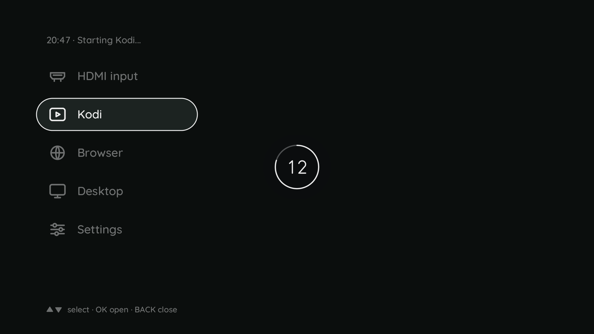

# h713-power - the power key

A short press shows a countdown of 15 s in the middle of the picture (TODO 2.38, since 11.10.2026): a ring with the
seconds, standby on its left, off on its right, the choice bright and underlined. Left and Right on the remote choose,
OK or a second press of the power key carries the choice out at once, Back cancels and the projector stays on; when the
time is up the choice is carried out. It starts on `default` of `/etc/h713/power.conf` - `poweroff`, the owner's choice.
Standby is offered only where it can happen (an image built with `--standby`, `[deep]` in `/sys/power/mem_sleep`,
crust `ready=1`); elsewhere the ring stands alone and ends in a power-off - on a release image, which runs the vendor
ARISC firmware since 22.10.2026 ([h713-arisc](h713-arisc.md)), always. Without a page or picture of ours on the wall (the console, no h713-osd)
nobody would see a countdown, and the default happens at once. The overlay is drawn by [h713-osd](h713-osd.md); each of
its frames keeps it one second, so a dead h713-power leaves nothing on the wall.



Where crust runs and can take the power-off (`h713-power status` says so; the HY300PRO-G-EU since `doku/188`, the HY310
since `doku/190`; experimental, `h713-arisc set crust`) that is a real off at 0.3 W, and the key or the remote wakes into
a fresh boot of about 30 s; elsewhere - under the vendor's ARISC firmware, what an image runs - it is the power-on gate,
2.9 W. The standby: 2.4 W on the HY310, 2.0 W on the HY300PRO-G-EU, the picture back about 5 s after the wake; with crust
the power supply hums in standby and when off (TODO 2.42).

```
h713-power set default standby   # the countdown starts on standby
h713-power set default poweroff  # back to the default
```

`set` takes every key of `/etc/h713/power.conf` (`default`, `long_s`, `ignore_s`, `remote`, `refused`; `short`, the
name before the countdown, still means `default`), checks the value, keeps the comments and is read at the next press;
it needs root. A long press always powers off, without the countdown.

The service runs on every image under `systemd-inhibit`, so logind's `HandlePowerKey=poweroff` is locked out while it
lives; if it dies, logind's power-off is back ([standby.md](../subsystems/standby.md)).

| Press | Does |
|---|---|
| short (released before `long_s`, 3 s) | the countdown (above); without a picture at once: standby if `default = standby` and it can happen, else power-off |
| during the countdown: Left, Right, OK, Back, power again | standby, off, carry out now, cancel, carry out now; in the remote's mouse mode OK is the left button (`BTN_LEFT`) and counts as OK: the remote's mouse node (1d5a:c081, no power key) is read and held with the others. Host tests only, not yet tried on a box |
| held for `long_s` | power-off, without waiting for the release |
| within `ignore_s` (2 s) after a resume the key itself woke | nothing: it is the press that woke the box |

The action comes on the release, so the key is up when the box goes to sleep. The last rule is why a
policy is needed at all: gpio-keys reports a key that woke the system as a `KEY_POWER`, which logind
would read as "power off" the moment the box is back. Measured so far only as the stray event of a timer
wake, which crust 0032 removed (`doku/165`, `doku/167`); a wake by the key itself has not been measured.
h713-power reads the event's `CLOCK_BOOTTIME` stamp and compares it with `wake` and `resume_ns` in the
arisc driver's `state` file.

```
h713-power status        # what a short press would do now, and why; who powers off (crust or the gate); the devices
h713-power set KEY VALUE # one key of power.conf, e.g. set short standby
h713-power run           # what the unit runs
```

**Why it cannot take the key away by accident.** The unit runs the tool under `systemd-inhibit
--what=handle-power-key:handle-suspend-key --mode=block`: logind keeps its own power-off and only steps
back while the lock is held. If h713-power dies, the lock goes with it, and the key powers off again.
That is the reason for a lock instead of `HandlePowerKey=ignore`, which would leave a dead key behind a
crashed service.

It listens on every input device that can send `KEY_POWER` - the key on the case (`gpio-keys`) and the
paired Bluetooth remote - and picks up a remote that connects later. `remote = off` in
`/etc/h713/power.conf` leaves the remote's key without any effect. `refused = poweroff | log` says what
a short press does when the kernel refuses the standby after all. Refused means `fail` in
`/sys/power/suspend_stats` moved, or neither counter did within 30 s. The 30 s start again when the tool
comes back from the freezer, and the counters are read before the time is judged: a slow freeze or resume
never turns a standby that happened into a power-off. A refusal and a power-off for a short press are
logged as warnings.

A standby that a **wake-up aborted** is not a refusal: a press while the box goes to sleep, or any interrupt
armed for wake-up, stops it in its last phases, and the projector stays on whatever `refused` says ("the
standby was aborted by a wake-up (IRQ n)"). The kernel's errno cannot tell this from a refusal - afbd's
scanout that does not stop and crust's RTC alarm that is due answer -EBUSY too - so h713-power reads
`/sys/power/pm_wakeup_irq`, the first wake-up interrupt of the try, and only when one of the step counters
in `/sys/power/suspend_stats` (`failed_freeze` to `failed_suspend_noirq`) moved, because the freezer clears
the file and an earlier failure would leave the last resume's interrupt there. The file exists with
`CONFIG_PM_DEBUG`; without it every failure is a refusal, as before (TODO 5.14, review U2).

**The picture after a standby - systemd's since the launcher.** What this paragraph describes below, h713-power did itself until
the launcher: any way into the sleep - the power key, the launcher's Standby entry, Kodi's Suspend menu,
`systemctl suspend` - must end with the picture and the mode back (35 of 35 standbys from every way, `doku/212` §1), so it is now `h713-sleep-pre.service` (`Before=sleep.target`:
remember the running mode, HDMI or Kodi, in `/run/h713-mode.resume` and end it) and `h713-sleep-post.service`
(`After=suspend.target`: `h713-mips-restart` when the MIPS is parked, then start what was remembered), both calling
`h713-mode` (`userspace/h713-power/h713-mode`). The resume file is also what tells [h713-keys](h713-keys.md) that the mode units that end now end for a sleep: no launcher opens for them, and the mode is not forgotten. `h713-mode rescue` is the same road for `h713-tv-rescue.service` (`OnFailure=` of `h713-tv@`): the restart of the display MIPS stops `h713-warp`, which ends the mode units with it, so the running ones are written to the same file first, the MIPS is restarted whether it is parked or not, and they are started again (a SIGKILL of `h713-tv` with Kodi running: Kodi back 9 s later, with the desktop 6 s, HY300PRO-G-EU 20.10.2026); the rescue still runs once per boot. `h713-mode hdmi` (the launcher's HDMI input) first touches `/run/h713-mode.ended` for the same reason, ends the mode units, and leaves the source on `auto`: `h713-tv ctl source hdmi` is only the way to get the ring back at once while the client is still quitting (0.27 s instead of ~2 s), and `auto` is how the box stands (a client before the ring, the ring when none runs), so it is said again when the last unit is gone; with no mode running only `auto` is said. h713-power only waits: while the post unit is `activating` a short press does
nothing; after a standby that did not happen (aborted by a wake-up, or refused with `refused = log`) it starts the post unit once
more, which does nothing twice. It also answers `can-standby` (exit 0 when a standby can happen now; the launcher's entry asks), takes
a datagram on `/run/h713-power.sock` (`H713_POWER_CTL`): `down` is a Power press that the launcher or a page of h713-settings took and let
go of the devices for - h713-power starts it on the device that has the key down, and the release or the 3 s decide as for any press, so a
long hold still powers off; `short` is a short press at once (and `down` for a key that is up already). It holds the remote's devices (`EVIOCGRAB`) for the 15 s of its countdown, so that Kodi does not move with Left, Right,
OK and Back. The earlier text, kept as the record of what h713-power did before:

The standby parks the display MIPS (cpu_comm, `suspend_late`), and
nothing in the kernel starts it again: after the resume the wall would stay on the console. When the
projector stays on after a standby - or after a refused one with `refused = log`, the park may have come
before the refusal - and the driver `sun50i-h713-mips` says `parked`, h713-power starts
`h713-mips-restart`. It runs beside the key loop; until it ends a short press does nothing (it is logged),
a press held for `long_s` still powers off. A run past 120 s hangs in the kernel: h713-power says so once
("h713-mips-restart hangs since N s"), a short press counts again, and no second restart is started beside
the hung one (TODO 5.14, review U6). A MIPS that is `running` is left alone; with no driver bound
the tool says so as a warning.

```
h713-mips-restart [FIRMWARE]   # FIRMWARE: /boot/mips/display.bin
```

It stops `h713-warp` and `h713-tv@*`, unbinds the HDMI receiver, writes FIRMWARE to the driver's
`restart` file (from the park: load and start like U-Boot; from a running MIPS: halt, load and start like
the vendor), binds the receiver, waits up to 60 s for its video node, and starts `h713-tv@` on it and
`h713-warp` again; once the picture path is back it rebuilds the audio DSP, which the standby powered off (msp
`error` -> its `reset` file, up to three attempts; a DSP that stays down is a warning, not an exit code). The
receiver is unbound only when no process holds its node, and bound again only on a
running MIPS, through `h713-hdcp-key --bind`: a plain bind runs the receiver's init sequence without the
device's HDCP 2.2 key (h713-hdcp-key.service deleted it after the boot, the step `THal_Vp_SetHDCP22Key`
is skipped), so the tool puts the key back into the tmpfs for exactly that bind. Whether a source then
gets HDCP 2.2 after a restart is not measured. Whatever ends the run, the services come back as far as the MIPS allows:
whether the receiver is bound is read from sysfs at the end, so a signal during the unbind or the bind leaves neither an
unbound receiver on a running MIPS nor a second bind, and the start limits of `h713-warp` and `h713-tv@` (3 starts in
60 s) are reset before the services start, so standbys in quick succession do not run into them. Exit 0 picture
path back, 1 the driver did not bring the MIPS up, 2 refused (MIPS untouched), 3 the MIPS runs but the
receiver, its node or a service did not come back, 4 ended by a signal. Each outcome is a journal line
(`journalctl -t h713-mips-restart`; run by hand also on stderr). The sequence brought
the picture back at the HY310 on 08.10.2026 from a running MIPS and from the park registers set by hand,
and on 09.10.2026 after real standbys in the R2 test image: six in one boot, picture back 3.9-5.2 s after
each wake (`doku/172`; the driver repeats U-Boot's TV top step the standby lost). The first runs called
h713-power's own `suspend()` and `picture_back()`; the real power key on the whole path, the wake by the key and
by the remote's IR key and the long press were measured with the owner at the box on 09.10.2026 (`doku/174` §1).

**Not measured yet.** The window after a key wake (`ignore_s`) is provisional: at the box the waking press
did not start a second standby (`doku/174` §1), but the window itself was not varied. Whether the remote's power key should suspend too, and whether a
refused standby should power off or only log, are the owner's decisions; the
defaults are on and power-off. Ignoring a short press while the picture comes back is provisional too.
`$H713_POWER_ROOT` replaces `/`, `$H713_SYSTEMCTL` the `systemctl` and `$H713_MIPS_RESTART` the
`h713-mips-restart` it calls; `$H713_ROOT` and `$H713_WAIT` do the same for h713-mips-restart (the tests,
`userspace/h713-power/tests/`, part of `release/tor.sh --tests`).
